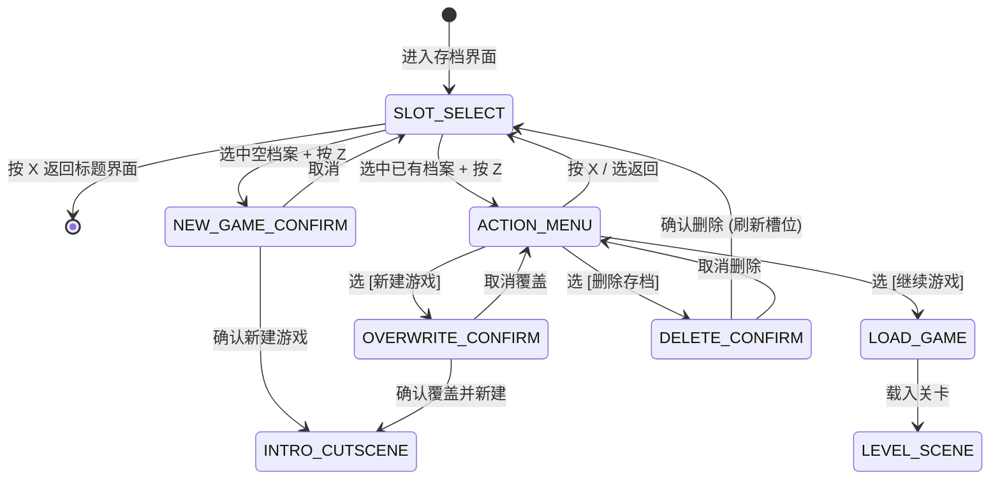

# 界面与交互系统（UI & Interaction）

本项目所有 UI 均严格基于 GBA 原始分辨率（$240 \times 160$）像素基准进行排版与适配。

---

## 一、信息查看系统（InfoViewer）

`scripts/info_viewer.gd` 负责全游戏所有面板的通用说明查看流程（按 R 键进入、方向键切换、R/X 退出），**不包含任何特定物品或角色的硬编码分支**，一切对象统一依赖 `get_info() -> String` 接口。

### 1. 经典“上下避让”排版原则
为了完全复刻 GBA《火焰纹章》原作体验，无论条目文本多长，说明框绝对不可遮挡玩家正在查看的当前行与手光标：

```text
[屏幕上半区条目 (row_pos.y < 70)]          [屏幕下半区条目 (row_pos.y >= 70)]
┌────────────────────────────┐             ┌────────────────────────────┐
│ [选择项] 铁弓 40/40 ◄(光标) │             │ ┌────────────────────────┐ │
│ ┌────────────────────────┐ │             │ │ 说明框（向上展开避让） │ │
│ │ 说明框（向下展开避让） │ │             │ └────────────────────────┘ │
│ └────────────────────────┘ │             │ [选择项] 伤药 3/3 ◄(光标)  │
└────────────────────────────┘             └────────────────────────────┘
```

- **水平位置自适应**：
  - 起始 X 坐标从当前条目左侧微调起步（`row_pos.x - 12.0`），自然对齐手光标腕部与条目左缘。
  - 当长文本向右延伸超出屏幕边界时，自动向左收缩平移，确保留有 4px 安全边距且内容不裁切。

---

## 二、角色信息面板（UnitInfoPanel）

对应场景 `scene/ui/unit_info_panel.tscn`（三页架构：角色信息 / 物品背包 / 武器与支援等级）。

### 1. 属性加成显示规范（方案 A）
- **基础数值位置锁定**：
  基础数值保持默认居中对齐（`HORIZONTAL_ALIGNMENT_CENTER`），位置在任何情况下均维持不变，与整列数值严格对齐。
- **加成数值自适应挂载**：
  通过 `BonusLabel` 挂载在数值控件右侧。系统通过字体测量基础数字宽度，将绿色 `+x`（增益）或橙红 `-x`（减益）精准定位于基础数值正右侧（保留 1px 呼吸间距）。

### 2. 焦点与导航编排
- 角色页静态属性由 Inspector 预设焦点图；
- 动态技能（最多 6 个，3×2 网格）与武器类型图标（最多 4 个，2×2 网格）在填充时由 `_link_grid_focus` 算法自动编排二维网格导航关系。

---

## 三、武器选择菜单（WeaponSelectMenu）

在进入战斗目标选择后，按确认键唤起武器选择菜单进行实时选装与战斗数值预览：

1. **升降指示箭头 (`scripts/stat_arrow.gd`)**：
   - 复刻 GBA 原版 UI 纹理 `res://assets/graphics/UI/up_and_down.png`（宽 30 高 10，左半 15x10 蓝▲上升，右半 15x10 红▼下降）。
   - 包含微动浮动动画（垂直上下轻微位移 1~1.5px），生动呈现换装带来的属性增减。

---

## 四、游戏标题界面（TitleScreen）

对应场景：`res://scene/ui/title_screen.tscn`（原 `scene/animation/interface.tscn` 迁移规范化）。

### 1. 节点构成与美术资源
- **根节点**：`Control`（视口 240×160，全屏铺满）。
- **背景图片**：`res://assets/graphics/UI/界面标题.png`（带“火焰之纹章 存在与虚无”定制 Logo 及城堡远景，240×160）。
- **提示文字**：`res://assets/graphics/UI/01.png`（"Press start" 贴图，尺寸 80×16），放置于底部浅色提示框（`offset_left = 80, offset_top = 107`）。
- **材质着色器**：挂载 `res://data/shader/press_start.gdshader`，实现经典 GBA 呼吸高亮闪烁效果。

### 2. 交互与状态控制
- 玩家按下确认键（Z、Enter、Space 或手柄 Start / A 键）：
  - 触发确认动画（加速快速频闪或短暂停顿锁定反馈）。
  - 调用 `get_tree().change_scene_to_file("res://scene/ui/save_slot_menu.tscn")` 进入存档选择界面。

---

## 五、存档系统与槽位界面（Save System & SaveSlotMenu）

底层管理器：`scripts/save_manager.gd`（Autoload 单例 `SaveManager`）。  
界面场景：`res://scene/ui/save_slot_menu.tscn`。

### 1. 存档数据存储规范（SaveManager）
- **物理路径**：Godot 用户安全目录 `user://save_slot_{1,2,3}.json`。
- **数据结构模型**：
  ```json
  {
    "version": 1,
    "slot_id": 1,
    "is_empty": false,
    "chapter_id": "level_0",
    "chapter_name": "序章 一寸之遥的呼吸",
    "protagonist_name": "忒",
    "protagonist_level": 1,
    "protagonist_class": "游牧民",
    "play_time_seconds": 180,
    "turn_count": 3,
    "timestamp": "2026-11-01 12:00",
    "difficulty": "普通",
    "party": [],
    "convoy": []
  }
  ```
- **核心接口约定**：
  - `get_slot_meta(slot_id: int) -> Dictionary`：快速读取槽位元数据（若文件不存在返回 `{"is_empty": true}`）。
  - `save_to_slot(slot_id: int, data: Dictionary) -> bool`：全量序列化并写入磁盘。
  - `load_from_slot(slot_id: int) -> Dictionary`：读取并反序列化指定槽位数据。
  - `delete_slot(slot_id: int) -> bool`：安全删除指定槽位 json 文件。
  - `current_slot: int`：记录当前游玩会话所属槽位 ID。

### 2. 界面布局与卡片规范（复刻 GBA 同人/原作精细排版）
- **视口规格**：240×160，顶部标题栏“记录”（`80, 4, 160, 22`）。
- **三槽位竖向卡片**：
  - **Slot 1**：Y = 27 ~ 58
  - **Slot 2**：Y = 65 ~ 96
  - **Slot 3**：Y = 103 ~ 134
  - **底部操作提示**：`Z 确定    X 返回`（靠左排布，Y = 142）
- **卡片内容呈现（去拥挤化）**：
  - **无档案状态**：底图为 [save_slot_empty.png](file:///E:/Dream/Lost/assets/graphics/UI/save_slot_empty.png)，中央单行置灰居中显示 `-- 没有档案 --`。
  - **已有档案状态**：底图为 [save_slot_active.png](file:///E:/Dream/Lost/assets/graphics/UI/save_slot_active.png)，中央单行白字居中显示章节名称（如 `序章 一寸之遥的呼吸`）。
- **右下角游玩时长框（PLAY-TIME）**：
  - 位于右下角独立 NinePatch 边框（`154, 126, 234, 156`）；
  - 动态响应当前聚焦光标所在的槽位，显示对应存档的 `PLAY-TIME`（如 `02:05` 或 `1:01.05`）；若选中槽位无档案则显示 `--:--`。
- **光标导航**：
  - FE 经典手指光标悬浮在当前选中槽位卡片左侧（`x = 34` 处），随光标上下滚动实时刷新右下角时长。

### 3. 操作状态机与二级菜单


- **二级操作菜单项**：
  1. `继续游戏`：调用 `SaveManager.load_from_slot(slot_id)`，切换至对应关卡场景。
  2. `新建游戏`：弹出二次警示框“覆盖当前档案？”，确认后初始化档案并切入开场动画。
  3. `删除存档`：弹出二次警示框“确定删除此档案？”，确认后删除文件并就地重绘为“没有档案”。
  4. `返回`：退出二级菜单，重回槽位选择。

---

## 六、序幕开场动画与旁白播报（IntroCutscene）

对应场景：`res://scene/ui/intro_cutscene.tscn`。  
前置触发：在任意槽位确认“新建游戏”后启动。

### 1. 视听风格与无框裸奔呈现
- **画面氛围**：四幅全屏定制 16-bit 像素原画（`res://assets/graphics/cutscene/intro_bg_{1..4}.png`）：
  - 幕 1：[intro_bg_1.png](file:///E:/Dream/Lost/assets/graphics/cutscene/intro_bg_1.png)（星空消逝的古老废墟与真理之门）
  - 幕 2：[intro_bg_2.png](file:///E:/Dream/Lost/assets/graphics/cutscene/intro_bg_2.png)（白色风化尘暴与残垣断壁之潮）
  - 幕 3：[intro_bg_3.png](file:///E:/Dream/Lost/assets/graphics/cutscene/intro_bg_3.png)（荒原上勒马回望的游牧青年忒）
  - 幕 4：[intro_bg_4.png](file:///E:/Dream/Lost/assets/graphics/cutscene/intro_bg_4.png)（策马迎击风暴、奔向拂晓的逆行者）
- **文字裸奔呈现**：彻底去除 `ContentBox` 九宫格边框，文字直接浮动在原画之上（借助黑色描边与轻量底色保护可读性），各幕切换时原画平滑交叉淡化（Cross-fade）。
- **打字机逐字播报**：
  - 定时器逐字推进文本显示（24 字/秒）。
  - **加速与跳过**：
    - 打字中按 `Z`：瞬间全显当前页所有文本。
    - 全显后按 `Z`：平滑交叉淡入下一幕原画与文字。
    - 按 `Start` (Enter / Space)：直接平滑淡入关卡。

### 2. 播报剧本（分四幕渐进叙事）
剧本来源于 `剧情_gemini.md`：
- **第一幕 · 宿命与真理暗门**：
  > 「很久以前，人们从不追问『我为何而生』。」  
  > 「因为高悬于天际的『命途』，早已为每一颗诞生的灵魂写好了注脚——农夫属于麦田，骑士属于王座，死者属于星辰。」  
  > 「直到二十年前，最渊博的贤者们推开了真理的暗门……门后没有神明，也没有宿命，只有一片沉默而荒凉的虚空。」
- **第二幕 · 概念崩解与虚无之潮**：
  > 「当『一切皆无意义』的真相如瘟疫般席卷大陆，宏大的秩序崩塌了。」  
  > 「有人熄灭了炉火，在倦怠中风化为骸骨；有人放纵着兽性，在末日的狂欢中挥起屠刀。」  
  > 「整个人类社会的迷茫与绝望，在大地上凝结成吞噬万物的暗影——『虚无之潮』。」
- **第三幕 · 彷徨之人的登场**：
  > 「在没有路标的荒原上，一个连自己的过去都已遗忘的青年，正握着一张拉不开远方的弓，独自徘徊……」  
  > 「青年名为忒。没有故乡，没有信仰，甚至不知道明天的太阳是否值得升起。」
- **第四幕 · 存在主义抉择与行动**：
  > 「然而，当生存的风暴迫近，手握缰绳与短弓的他，仍本能地策马前行——」  
  > 「在荒谬的世界里，哪怕没有终极的意义，选择与行动……就是存在的证明。」

---

## 七、关卡系统菜单与进度保存（LevelSystemUI & MapMenu）

对应脚本：`scripts/level_system_ui.gd` 与 `scripts/map_menu.gd`。

### 1. 唤出方式
- **空地点击**：光标停在空地（无单位/非敌人）按 `Z` 键唤出地图系统菜单。
- **菜单快捷键**：按键盘 `Enter` / `Start` 键直接唤出。
- **行动菜单直达**：单位移动后展开的固定项列表中追加了 `[保存]` 与 `[主菜单]`。

### 2. 功能项与执行流
- **结束**：主动终结玩家回合，进入敌方行动阶段。
- **保存**：将当前关卡上下文、回合数、主角数值存入当前槽位，并在屏幕上方弹出 1 秒平滑淡入淡出的浮动提示条（`进度已保存！`）。
- **主菜单**：弹出居中二次确认弹窗（`返回开始界面？[确定] [取消]`），确认后平滑渐黑返回标题画面。

---

## 八、全局平滑转场（SceneTransition）

Autoload 单例：`SceneTransition`（`scripts/scene_transition.gd`）。
- 图层置于 CanvasLayer 128（最顶层）。
- 场景切换采用标准的 `黑屏淡出 (0.25s~0.35s) -> 异步换场并等一帧渲染就绪 -> 黑屏淡入 (0.25s~0.35s)` 流水线。
- 彻底消除标题到存档、选档到打字机、关卡切换时的卡顿、掉帧与画面突变撕裂感。


